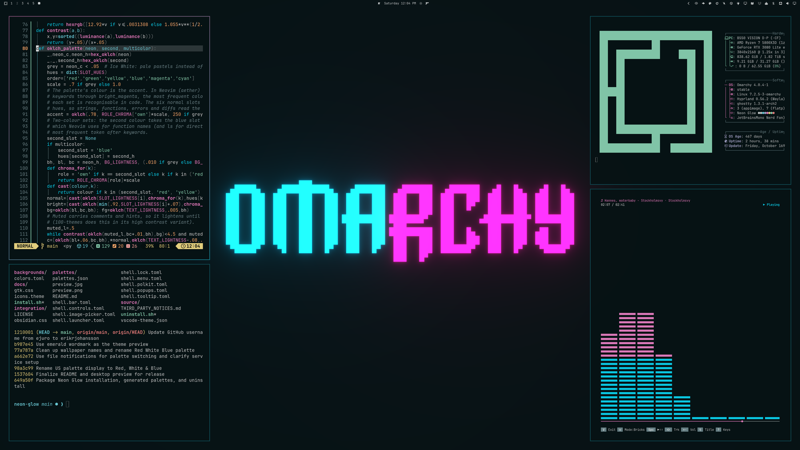

# Neon Glow

One Omarchy theme. Seven color palettes. Change the wallpaper and the desktop colors follow.



7 wallpapers in 4K: the Omarchy wordmark in soft neon for each color, on a dark background that matches the window and terminal colors.

**Requires Omarchy 4 / Quattro with Omarchy Shell.** Tested on `4.0.4`; older Waybar-based Omarchy versions are unsupported.

## Install

Automatic color switching requires a small background service that watches wallpaper changes and applies the matching palette while Neon Glow is selected. The command below installs both the theme and this service:

```sh
omarchy theme install https://github.com/erikrjohansson/omarchy-neon-glow-theme && bash ~/.config/omarchy/themes/neon-glow/install.sh
```

**Already installed the theme?** Run this once to install the background service and enable automatic color switching:

```sh
bash ~/.config/omarchy/themes/neon-glow/install.sh
```

That's it. Neon Glow activates and the small palette service starts automatically at login. Use the normal background picker or your wallpaper shortcut.

The service remains running when you switch themes, but only applies changes while Neon Glow is selected. It sleeps between file-change notifications instead of polling. Switching back resumes automatic color matching. To remove the service, follow the [remove instructions](#remove) below.

The standard theme installer alone provides the wallpapers and a static Cyberpunk palette. The setup command enables the automatic color switching. No root access, extra Python packages, or edits to Neovim, cliamp, terminal, or other application config files are needed by setup.

## Update

Update your installed themes, then run setup again so the palettes are regenerated:

```sh
omarchy theme update
bash ~/.config/omarchy/themes/neon-glow/install.sh
```

**Updating from an earlier version:** the logo wallpapers and the Blue, Blue & Yellow, Ultraviolet, Ruby Red and Vaporwave sets were removed, as they were too close to other sets. A wallpaper that is still selected keeps working until you pick a new one: a logo keeps its own colors, and a removed set uses the nearest remaining palette (Cyberpunk for Blue, Red, White & Blue for Blue & Yellow, Hot Coral for Ruby Red, Orchid for Ultraviolet and Vaporwave).

Also rerun setup after an Omarchy upgrade that changes theme templates. It regenerates compatible app configs and preserves the currently selected wallpaper when Neon Glow is already active.

## Remove

First remove the background service:

```sh
bash ~/.config/omarchy/themes/neon-glow/uninstall.sh
```

This removes the user service and generated palette cache; the current appearance stays. To remove the theme completely, switch to another theme (for example with `omarchy theme switcher`), then:

```sh
omarchy theme remove neon-glow
```

## Colors


Cyberpunk · Emerald · Orchid · Gold · Ice White · Hot Coral · Red, White & Blue

The colors are tuned for comfortable reading: a dark background lightly tinted by each wallpaper, soft grey text, and calm terminal colors. Red, green, yellow and blue stay true colors, so errors, diffs and warnings always read the same. Each wallpaper's color is the accent: keywords, window borders, selections, the active workspace, folder icons and menu highlights follow it.

Two-color wallpapers (Cyberpunk, Red, White & Blue) also use their second color, including a two-color window border. cliamp's default theme picks up each palette's colors too.

## How it works

Setup generates all 7 palettes using your installed Omarchy templates and any user template overrides. Generated files live in `~/.local/state/neon-glow/palettes/`, outside the repository. Executable app configurations such as Neovim Lua and terminal configs are regenerated locally instead of relying on bundled versions.

A small user service uses Linux file-change notifications (inotify) to watch the selected theme and wallpaper, applies the matching palette, and uses Omarchy's own refresh commands. It remains running but does not apply changes to other themes, and has no periodic polling while idle. Failed palette updates are retried after a short delay. Custom wallpapers without a palette mapping retain the current colors.

```sh
systemctl --user status neon-glow.service
journalctl --user -u neon-glow.service
```

Wallpapers and original theme by Erik Johansson. Based on Emerald Glow and Omarchy. [MIT license](LICENSE) · [Third-party notices](THIRD_PARTY_NOTICES.md)
